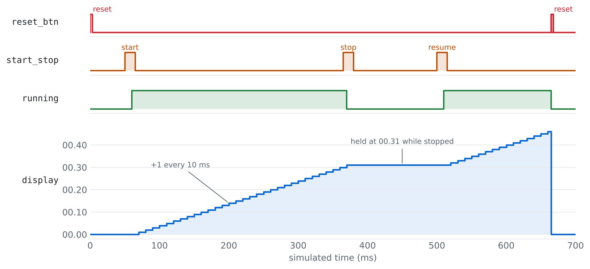
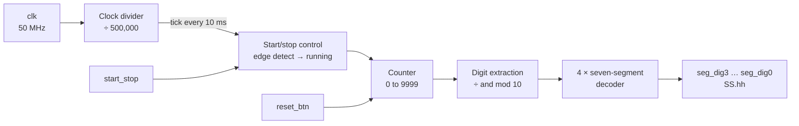

# FPGA Stopwatch in VHDL

This is a stopwatch I built in VHDL for my Digital Design II course at the University of Bahrain in 2024, back in my second year of computer engineering. It runs on an FPGA board with a 50 MHz clock and shows the time on four seven-segment displays, from 00.00 up to 99.99 seconds. One button starts and stops it, and another one resets it.

I'm in my fourth year now, so I cleaned it up and put it on GitHub. The logic is the same as what I wrote back then. I tidied up the comments and added testbenches, this README, and the simulation plot below.



That plot comes from the simulation. I press start and it counts up, then I stop it and it holds at 00.31. After that I resume it and finally hit reset.

## How it works

The board clock runs at 50 MHz, which is way too fast to count directly, so the first thing the design does is slow it down. A counter goes from 0 to 499,999, and every time it wraps around, 10 ms have passed. The rest of the stopwatch only does something on those 10 ms ticks.

On each tick it checks the start/stop button. If the button was 0 on the last tick and is 1 now, the stopwatch switches between running and stopped. Because the button only gets looked at every 10 ms, most of the bouncing from the button contacts is never seen, so this also works as a simple debounce.

While it's running, a counter goes up by one every tick, from 0 to 9999, and then rolls back to 0. That number is the time in hundredths of a second. To show it, I split it into four decimal digits using division and mod 10, and each digit goes through its own seven-segment decoder.



### The display

| Output     | Digit                  | For 12.34 s |
|------------|------------------------|:-----------:|
| `seg_dig3` | tens of seconds        | 1           |
| `seg_dig2` | seconds                | 2           |
| `seg_dig1` | tenths of a second     | 3           |
| `seg_dig0` | hundredths of a second | 4           |

Each output is 7 bits, with bit 0 as segment a and bit 6 as segment g. The segments are active-low, meaning a 0 turns the segment on. That matches common-anode displays like the ones on the Terasic DE-series boards.

```
   ─ a ─
  f     b
   ─ g ─
  e     c
   ─ d ─
```

## Files

```
src/
  stopwatch.vhd                 top level (divider, button logic, counter, digits)
  seven_segment_decoder.vhd     turns one digit into a segment pattern
  debounce.vhd                  counter-based debouncer (not used in the top level, see below)
sim/
  tb_stopwatch.vhd              testbench for the whole stopwatch
  tb_seven_segment_decoder.vhd  checks all 16 input codes
  tb_debounce.vhd               checks that button bounce gets filtered out
docs/
  simulation.png                the plot above
Makefile                        runs the testbenches
```

## Running the simulation

The testbenches run on [GHDL](https://github.com/ghdl/ghdl), which is free and open source. You need version 3.0 or newer because the testbenches use VHDL-2008.

```bash
make test
```

The stopwatch testbench runs the design at the real 50 MHz clock and reads the time straight off the seven-segment outputs, the same way you'd read the display. It checks reset, starting, the counting speed, stopping, resuming, resetting while it's running, and rolling over from 99.99 to 00.00. It simulates 0.85 s of real time, which is around 42 million clock cycles, so give it a minute or two.

This is what it prints:

```
After reset                  display = 00.00
Running                      display = 00.20
100 ms later                 display = 00.30
Stopped                      display = 00.31
Still stopped 100 ms later   display = 00.31
Resumed                      display = 00.36
Reset while running          display = 00.00
Jumped near the end          display = 99.95
Wrapped                      display = 00.00
stopwatch: all checks PASSED
```

If you don't have `make`:

```bash
mkdir -p build && cd build
ghdl -a --std=08 ../src/*.vhd ../sim/*.vhd
ghdl --elab-run --std=08 tb_seven_segment_decoder
ghdl --elab-run --std=08 tb_debounce
ghdl --elab-run --std=08 tb_stopwatch
```

## Putting it on a board

| Port                  | Direction | Connect to                                 |
|-----------------------|-----------|--------------------------------------------|
| `clk`                 | in        | 50 MHz board clock                         |
| `reset_btn`           | in        | button or switch, `1` means reset          |
| `start_stop`          | in        | button or switch, `1` means pressed        |
| `seg_dig0`–`seg_dig3` | out       | the four seven-segment displays            |

In Quartus, make a new project for your board's FPGA, add the three files from `src/`, set `stopwatch` as the top-level entity, assign the pins from your board's manual, then compile and program it.

Watch out for the buttons. Both inputs are active-high, but on a lot of boards the push buttons read 0 when pressed. If yours are like that, use slide switches instead or invert the inputs. Also, if your board's clock isn't 50 MHz, change `CLK_FREQ` in `stopwatch.vhd`.

## What I'd do differently now

Looking at this code two years later, there are a few things I'd change:

- I named the counter `milliseconds`, but it actually counts hundredths of a second. Something like `centiseconds` would have been clearer.
- I wrote a separate debounce module but never connected it in the top level. The 10 ms sampling ended up handling the bounce anyway. The module still works on its own (it has its own testbench), but I should have either used it or left it out.
- The buttons go straight into the logic without a synchronizer. Two flip-flops in front of each input would protect against metastability.
- Getting the digits with division and mod works, but it creates a lot of combinational logic. Four chained BCD counters, each going from 0 to 9, would be much smaller.
- The clock frequency is a constant and not a generic, so the testbench has to simulate every single clock cycle. With generics it could run much faster.
- I never turned on the decimal point between the seconds and the hundredths.

## License

[MIT](LICENSE)
